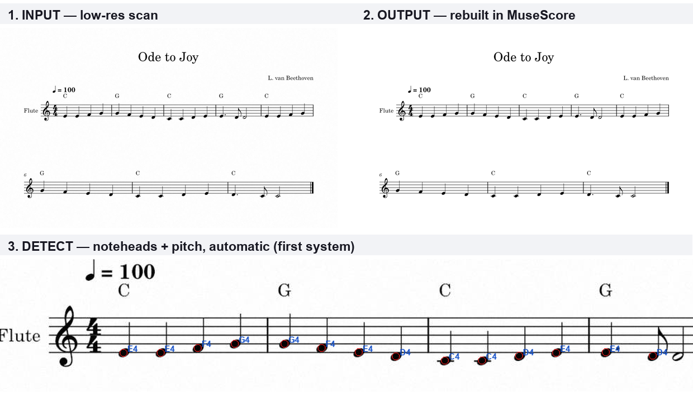

# scan-score-to-musescore

<p align="center">
  <b>Scanned sheet music → editable MuseScore score. Semi-automatic, hackable, no ML model.</b><br>
  <sub>扫描版五线谱 → 可编辑的 MuseScore 工程 · 半自动 · 可改 · 不用模型</sub>
</p>

<p align="center">
  <a href="https://www.python.org/"></a>
  <a href="LICENSE"></a>
  <a href="#requirements"></a>
  
  <a href="https://musescore.org/"></a>
</p>

<p align="center">
  <a href="#english">English</a> ·
  <a href="#简体中文">简体中文</a>
</p>

<p align="center">
  
</p>

---

## English

### Why this exists

Optical music recognition is usually either a black box (commercial OMR) or a research stack you can't debug. This repo is the opposite: **~1k lines of plain Python** that turn a scan into MusicXML, then let MuseScore do the engraving. It's designed to be *good enough to save you hours, honest about what it can't do*, and easy to fix when it gets a note wrong.

No neural network, no training data, no GPU. Just geometry: staff-line fitting, notehead blobs, coordinate → pitch math, then a human-in-the-loop checklist for rhythm and ornaments.

> **It is not a general OMR.** It targets monophonic melodies and lead sheets. Dense piano chords, full scores, handwritten music and tablature are out of scope.

> **It pairs with [`musescore-score`](https://github.com/HugoOu/dsh-musescore-skills).** This repo stops at MusicXML; the companion skill engraves and exports it, and `verify.py` calls the companion's `mscore.py`. To install both in one checkout, start from the [dsh-musescore-skills bundle](https://github.com/HugoOu/dsh-musescore-skills). [How the two fit together ↓](#using-it-with-musescore-score)

### What it does

- **Native-resolution extraction** — scanned PDFs are usually a 72–150 dpi bitmap per page. Re-rendering at 300 dpi only produces a bigger blur; the toolkit pulls the embedded image instead.
- **Staff & system detection** — finds 5-line staves, their spacing, and page/system coordinates.
- **Notehead detection → pitch** — column-run blobs (a notehead is a fat vertical run, a stem is thin, a staff line is flat), mapped to pitch through half-staff-space steps, with key-signature spelling (F major ⇒ every B is B♭).
- **JSON → MusicXML** — a tiny builder plus an extension layer for chord symbols, 1st/2nd endings, repeats, Segno/Coda, D.S. al Coda and multi-measure rests.
- **MuseScore in the loop** — headless `.mscz/.pdf/.png/.mp3` export and a metadata check, so you always eyeball the engraved result.

### Demo

A synthetic "low-res scan" of *Ode to Joy* (public domain) through the whole pipeline — the image at the top of this README. On this 150-dpi-ish scan, **27 of 30 noteheads were recovered**, all detected pitches were correct, and the three misses were exactly the cases the checklist warns about: an **open notehead** (half note) and a **repeated half note**. That is the point of the tool: it gets you 90% there, and the checklist tells you where to look.

Reproduce it:

```bash
python scripts/score_from_json.py examples/ode_to_joy/score.json out/ode.musicxml
python scripts/verify.py out/ode.musicxml out --pdf --dpi 200      # clean render
python scripts/pdf_scan.py docs/images/demo-scan.png out/pages
python scripts/pitchmap.py out/pages --clef treble --key 0 --x-min 250 \
       --annotate out/detected.png
```

### How it works

```
PDF / image
   │  pdf_scan.py      extract native bitmap; fit staff systems
   ▼
pages + systems.json
   │  pitchmap.py      notehead blobs → (x, y) → pitch candidates
   ▼
notes.json
   │  probe.py         zoom / ASCII checks for "on a line" vs "in a space"
   │  (you)            fix rhythm, ties, ornaments, structure → score.json
   ▼
score.json
   │  score_from_json.py + mxml.py + mxml_ext.py
   ▼
MusicXML
   │  MuseScore CLI
   ▼
.mscz / .pdf / .png / .mp3
```

The key design choices:

| Problem | Solution |
|---|---|
| Scanned PDF is a low-res bitmap, not vector | `pdfimages -all` instead of `pdftoppm`; never upscale |
| Pixel thresholds break on the next scan | every threshold is relative to the detected staff spacing |
| Noteheads touch staff lines | detect fat vertical runs instead of removing staff lines |
| "On a line" vs "in a space" is a 7 px difference | `probe.py --ascii` prints the exact pixel rows, with original y coordinates |
| MusicXML lacks endings/D.S./Coda in most builders | `mxml_ext.py` injects them in the correct element order |

### Requirements

- Python 3.10+, `numpy`, `Pillow`
- [poppler](https://poppler.freedesktop.org/) — `pdfimages`, `pdftoppm`, `pdfinfo` (TeX Live ships them on Windows)
- [MuseScore 4](https://musescore.org/) for engraving and export — driven by `verify.py` through the companion `mscore.py`, or your own wrapper via `--mscore`

```bash
pip install numpy pillow
```

### Quick start

```bash
git clone https://github.com/HugoOu/scan-score-to-musescore.git
cd scan-score-to-musescore

# 1. pages + staff systems (native bitmap for scans)
python scripts/pdf_scan.py myscore.pdf work

# 2. notehead candidates + pitches
python scripts/pitchmap.py work --clef treble --key -1 --x-min 200

# 3. verify line-vs-space on ambiguous notes
python scripts/probe.py work/page-1.png 240 820 420 950 --scale 5 --lines 529,544,559,574,589
python scripts/probe.py work/page-1.png 240 820 420 950 --ascii

# 4. write measures as JSON (template: assets/example_score.json)
python scripts/score_from_json.py my_score.json out.musicxml

# 5. engrave, render, inspect
python scripts/verify.py out.musicxml build --pdf --dpi 130
```

`verify.py` drives MuseScore through the companion skill's `mscore.py` (default `~/.dsh/skills/musescore-score/scripts/mscore.py`). Point it somewhere else with `--mscore PATH`, or call MuseScore directly:

```bash
musescore4 -o out.mscz out.musicxml
musescore4 -o out.pdf out.mscz
```

### CLI reference

| Script | Purpose | Output |
|---|---|---|
| `pdf_scan.py` | PDF/image → pages, staff systems | `page-*.png`, `systems.json` |
| `pitchmap.py` | notehead detection + pitch mapping | `notes.json`, optional annotated PNG |
| `probe.py` | zoom / ASCII / staff-line ruler | `crop.png` or stdout |
| `score_from_json.py` | measure JSON → MusicXML | `*.musicxml` |
| `verify.py` | convert + render + metadata check | `.mscz/.pdf/*.png` |

### As a DeepSeek Harness skill

`SKILL.md` is written as a DSH skill entry. Drop the directory into `~/.dsh/skills/scan-score-to-musescore/` and it triggers on requests like *"transcribe this scan into MuseScore"*.

For the engraving half, install the sibling [`musescore-score`](https://github.com/HugoOu/dsh-musescore-skills) next to it — `verify.py` looks for its `mscore.py` in `~/.dsh/skills/musescore-score/`. Installing both from the bundle is the one-step route.

### Using it with musescore-score

The two repos are one pipeline, split at MusicXML:

| Stage | Lives in | Scripts |
|---|---|---|
| Image → pitch candidates | this repo | `pdf_scan.py`, `pitchmap.py`, `probe.py` |
| Candidates (hand-checked) → MusicXML | this repo | `score_from_json.py` + `mxml.py` + `mxml_ext.py` |
| MusicXML → `.mscz` / PDF / PNG / MP3 / MIDI | [`musescore-score`](https://github.com/HugoOu/dsh-musescore-skills) | `mscore.py` |
| Engrave, render, eyeball | this repo | `verify.py` (calls `mscore.py`) |

Three ways to install:

1. **Both skills at once (recommended for DSH).** Clone the [dsh-musescore-skills](https://github.com/HugoOu/dsh-musescore-skills) bundle and copy `skills/*` into `~/.dsh/skills/`. That is this toolkit plus the engraver, already wired together.
2. **This repo alone.** Copy it into `~/.dsh/skills/scan-score-to-musescore/`, then install `musescore-score` separately. Steps 1–4 of the quick start work without it; only the final engrave/render/verify step stops with a clear "install musescore-score" message.
3. **Plain Python, no DSH.** Run the scripts from the checkout and call `musescore4 -o …` yourself; no skill install needed.

The bundle's README carries the combined workflow diagram and the troubleshooting table; this repo keeps the step-by-step scan walkthrough, the accuracy notes and the public-domain *Ode to Joy* example.

### Keeping the bundled copy in sync

[`dsh-musescore-skills`](https://github.com/HugoOu/dsh-musescore-skills) vendors this toolkit at `skills/scan-score-to-musescore/`, byte for byte. **This repository is the source of truth**: make scan-toolkit changes here, then sync them into a sibling checkout:

```bash
python tools/sync_scan_skill.py --bundle ../dsh-musescore-skills           # write the vendored copy
python tools/sync_scan_skill.py --bundle ../dsh-musescore-skills --check   # verify only (CI-friendly)
```

Only `verify.py` reaches into the other skill (`mscore.py`, for engraving); every other file in the vendored copy is self-contained.

### Accuracy & limitations

- Recall on clean 150–300 dpi monophonic scans: **85–95%** of noteheads; pitch is correct for nearly all detected heads.
- **Open noteheads (half/whole notes) are mostly missed** — column-run detection needs a filled head.
- Ornaments, slurs/ties, and precise rhythm are **not** inferred; the checklist asks you to add them while looking at the scan.
- Chords on one stem are merged by the de-duplication pass; split them manually.
- Deskewing is not implemented — scans tilted by more than ~2° should be straightened first.

### Legal & copyright

**This repository contains tool code only — no scores, no scans, no generated outputs.** Use it on music you own, music you are licensed to process, or public-domain works. Transcribing and redistributing copyrighted music can infringe copyright even when the transcription is produced by your own tool; the license below covers the software, not its output.

The demo uses *Ode to Joy* (Beethoven, public domain) and a synthetic scan generated by the project itself.

### Contributing

Issues and PRs are welcome. Good first contributions: deskewing, open-notehead detection, chord splitting, and a `--ground-truth` accuracy report. Please don't attach copyrighted scores to issues — a cropped staff with the copyright notice removed is still not okay to redistribute; describe the failure instead.

### License

MIT — see [LICENSE](LICENSE). Third-party tools (MuseScore, poppler, NumPy, Pillow) are invoked as external programs or imported as dependencies; they are not redistributed here.

---

## 简体中文

### 为什么做这个

光学识谱（OMR）要么是买不到源码的黑盒，要么是改不动的论文工程。这个仓库是反过来的：**约一千行纯 Python**，把扫描谱变成 MusicXML，再交给 MuseScore 排版。目标是「省下你几小时打谱时间」，并且**对自己的能力边界诚实**——哪里可能错，检查清单直接告诉你。

没有神经网络、没有训练数据、不需要 GPU。全是几何：拟合谱线、找符头、坐标换算音高，再用一张「人眼核对清单」补节奏和装饰音。

> **它不是通用 OMR。** 面向单声部旋律和 lead sheet。钢琴密集和弦、总谱、手写谱、六线谱都不在范围内。

> **和 [`musescore-score`](https://github.com/HugoOu/dsh-musescore-skills) 是一对。** 本仓库只做到 MusicXML，排版/导出交给配套技能，`verify.py` 调用它的 `mscore.py`。想一次装齐两个技能，直接用 [dsh-musescore-skills](https://github.com/HugoOu/dsh-musescore-skills) 合集。[两者怎么配合 ↓](#和-musescore-score-配合使用)

### 它做什么

- **按原生分辨率抽图**：扫描 PDF 通常每页塞了一张 72–150 dpi 位图，按 300 dpi 重渲染只会更大更糊；工具直接抽内嵌原图。
- **找五线谱行**：定位 5 条谱线、线距，以及每行谱在页面上的坐标。
- **符头 → 音高**：把「纵向连续的胖暗段」当符头（符干细、谱线扁），按半个线距一个音级换算音高，并按调号拼写（F 大调里 B 一律写成 B♭）。
- **JSON → MusicXML**：自带最小写出器，另一个扩展层负责和弦符号、1./2. 房子、反复、Segno/Coda、D.S. al Coda、多小节休止。
- **把 MuseScore 拉进回路**：无头导出 `.mscz/.pdf/.png/.mp3`，并打印页数/小节数/和弦数，逼你回图核对。

### 效果

README 顶部那张图就是完整流程：一张合成的低分辨率《欢乐颂》扫描件（公有领域）→ 自动检测的符头与音高 → MuseScore 重排结果。这张约 150 dpi 的扫描上，**30 个符头抓到了 27 个，已检出的音高全部正确**；漏掉的 3 个正好是检查清单里写的典型情况：**空心符头**（二分音符）和**重复的二分音符**。这正是工具的定位：帮你完成 90%，剩下 10% 告诉你去哪里看。

复现：

```bash
python scripts/score_from_json.py examples/ode_to_joy/score.json out/ode.musicxml
python scripts/verify.py out/ode.musicxml out --pdf --dpi 200      # 干净的原始谱
python scripts/pdf_scan.py docs/images/demo-scan.png out/pages
python scripts/pitchmap.py out/pages --clef treble --key 0 --x-min 250 \
       --annotate out/detected.png
```

### 工作流

```
PDF / 图片
   │  pdf_scan.py      抽原生位图；拟合五线谱行
   ▼
页面 + systems.json
   │  pitchmap.py      符头候选 → (x, y) → 音高候选
   ▼
notes.json
   │  probe.py         放大 / 字符画，确认“线音还是间音”
   │  （你）            补节奏、延音线、装饰音、反复结构 → score.json
   ▼
score.json
   │  score_from_json.py + mxml.py + mxml_ext.py
   ▼
MusicXML
   │  MuseScore 命令行
   ▼
.mscz / .pdf / .png / .mp3
```

关键取舍：

| 问题 | 做法 |
|---|---|
| 扫描 PDF 是低分辨率位图，不是矢量 | 用 `pdfimages -all` 抽原图，绝不放大 |
| 写死像素阈值换张扫描就崩 | 所有阈值按检测到的线距取相对值 |
| 符头和谱线粘在一起 | 用「纵向连续暗段」特征，不做形态学去线 |
| 线音/间音只差 7 像素，看图易错 | `probe.py --ascii` 打印带原始 y 坐标的字符画 |
| 常见 MusicXML 库不写房子/D.S./Coda | `mxml_ext.py` 按正确元素顺序注入 |

### 依赖

- Python 3.10+、`numpy`、`Pillow`
- [poppler](https://poppler.freedesktop.org/)（`pdfimages` / `pdftoppm` / `pdfinfo`；Windows 上 TeX Live 自带）
- [MuseScore 4](https://musescore.org/)（排版与导出；由 `verify.py` 通过配套技能的 `mscore.py` 驱动，也可用 `--mscore` 指向自己的包装脚本）

```bash
pip install numpy pillow
```

### 快速开始

```bash
git clone https://github.com/HugoOu/scan-score-to-musescore.git
cd scan-score-to-musescore

python scripts/pdf_scan.py myscore.pdf work
python scripts/pitchmap.py work --clef treble --key -1 --x-min 200
python scripts/probe.py work/page-1.png 240 820 420 950 --scale 5 --lines 529,544,559,574,589
python scripts/probe.py work/page-1.png 240 820 420 950 --ascii
python scripts/score_from_json.py my_score.json out.musicxml
python scripts/verify.py out.musicxml build --pdf --dpi 130
```

`verify.py` 通过配套技能的 `mscore.py` 调用 MuseScore（默认 `~/.dsh/skills/musescore-score/scripts/mscore.py`）；也可用 `--mscore PATH` 指定，或直接调 `musescore4 -o …`。

### 命令一览

| 脚本 | 作用 | 产出 |
|---|---|---|
| `pdf_scan.py` | PDF/图片 → 每页图 + 五线谱行 | `page-*.png`、`systems.json` |
| `pitchmap.py` | 符头检测 + 音高换算 | `notes.json`、可选标注图 |
| `probe.py` | 局部放大 / ASCII / 谱线标尺 | `crop.png` 或 stdout |
| `score_from_json.py` | 逐小节 JSON → MusicXML | `*.musicxml` |
| `verify.py` | 编译 + 出图 + 元数据体检 | `.mscz/.pdf/*.png` |

### 作为 DeepSeek Harness 技能

`SKILL.md` 就是 DSH 技能入口。把整个目录放进 `~/.dsh/skills/scan-score-to-musescore/`，之后说「把这张谱转成 MuseScore」「识谱」就会触发。

排版那半段需要配套的 [`musescore-score`](https://github.com/HugoOu/dsh-musescore-skills)：`verify.py` 会去 `~/.dsh/skills/musescore-score/` 找它的 `mscore.py`。两个一起装最省事。

### 和 musescore-score 配合使用

两个仓库是一条流水线，在 MusicXML 处分界：

| 阶段 | 在哪个仓库 | 脚本 |
|---|---|---|
| 图片 → 音高候选 | 本仓库 | `pdf_scan.py`、`pitchmap.py`、`probe.py` |
| 人工核对后的候选 → MusicXML | 本仓库 | `score_from_json.py` + `mxml.py` + `mxml_ext.py` |
| MusicXML → `.mscz` / PDF / PNG / MP3 / MIDI | [`musescore-score`](https://github.com/HugoOu/dsh-musescore-skills) | `mscore.py` |
| 排版、出图、核对 | 本仓库 | `verify.py`（调用 `mscore.py`） |

三种装法：

1. **一次装两个（DSH 推荐）**：克隆 [dsh-musescore-skills](https://github.com/HugoOu/dsh-musescore-skills) 合集，把 `skills/*` 拷进 `~/.dsh/skills/`。里面就是这套识谱工具 + 排版引擎，且已经互相接好。
2. **只装本仓库**：拷到 `~/.dsh/skills/scan-score-to-musescore/`，再单独装 `musescore-score`。前 4 步不装也能跑；只有最后的排版/出图/核对会停下来提示「先装 musescore-score」。
3. **完全不用 DSH**：脚本就是普通 Python，直接在仓库里跑，最后用 `musescore4 -o …` 自己导出。

合集的 README 有整条流水线图和排错表；本仓库保留逐步识谱教程、精度边界和公有领域的《欢乐颂》示例。

### 保持合集里的副本同步

[`dsh-musescore-skills`](https://github.com/HugoOu/dsh-musescore-skills) 在 `skills/scan-score-to-musescore/` 放了一份逐字节副本。**本仓库是扫描技能的源码真源**：改动请先落在本仓库，再同步到相邻的合集 checkout：

```bash
python tools/sync_scan_skill.py --bundle ../dsh-musescore-skills           # 写入合集
python tools/sync_scan_skill.py --bundle ../dsh-musescore-skills --check   # 只校验（可直接用于 CI）
```

只有 `verify.py` 会用到另一个技能（`mscore.py`，负责排版/导出），合集里其余文件都是自包含的。

### 精度与边界

- 干净的 150–300 dpi 单声部扫描：符头召回率 **85–95%**，已检出的音高基本全对。
- **空心符头（二分/全音符）基本检不到**——列扫描需要实心符头。
- 装饰音、延音线/圆滑线、精确节奏**不会自动推断**，需要对着原图补。
- 同符干上的和弦会被去重逻辑合并，需手工拆开。
- 没做倾斜校正；倾斜超过约 2° 的扫描请先摆正。

### 版权与合法使用

**仓库里只有工具代码，没有任何乐谱、扫描件或生成结果。** 请只处理你拥有版权、获得授权、或属于公有领域的乐谱。把受版权保护的作品转写后公开分发，即使工具是你自己写的，也可能构成侵权——下面的许可证只覆盖软件，不覆盖它的输出。

演示用的是《欢乐颂》（贝多芬，公有领域），以及项目自己合成的扫描件。

### 参与贡献

欢迎 issue 和 PR。适合入手的题目：倾斜校正、空心符头检测、和弦拆分、`--ground-truth` 精度报告。**不要在 issue 里附受版权保护的谱**——裁掉版权声明的一小块谱面同样不适合再分发，描述失败现象即可。

### 许可证

MIT，见 [LICENSE](LICENSE)。MuseScore、poppler、NumPy、Pillow 均以外部程序调用或依赖形式使用，本仓库不重新分发它们。
